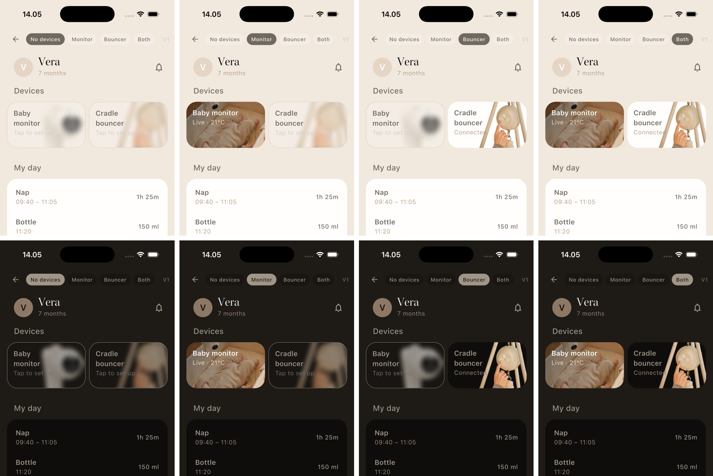
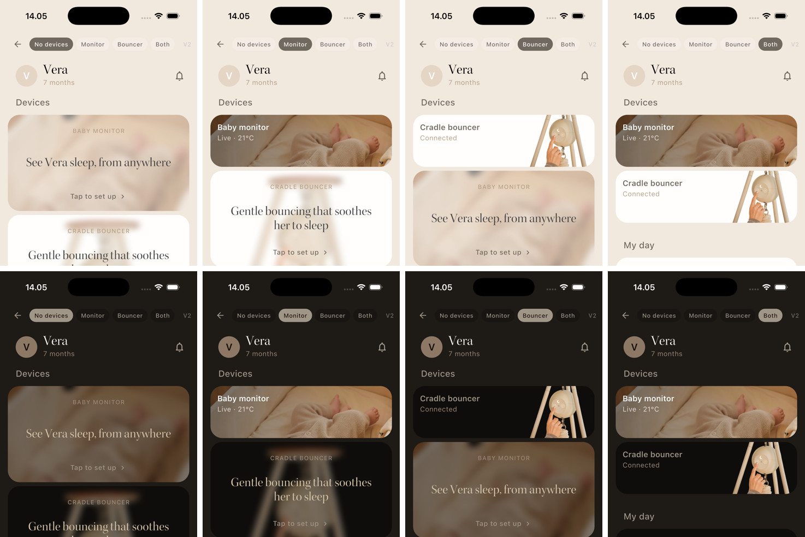
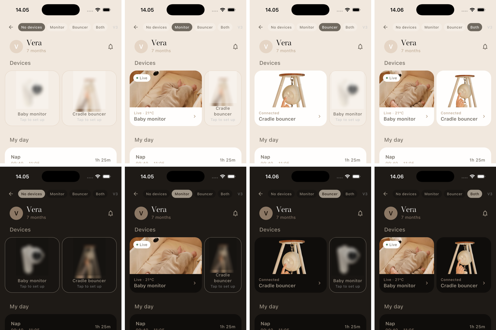
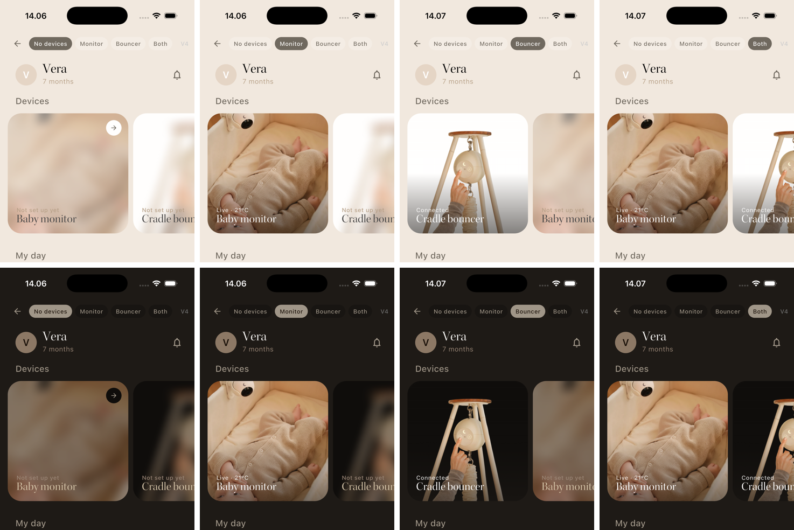
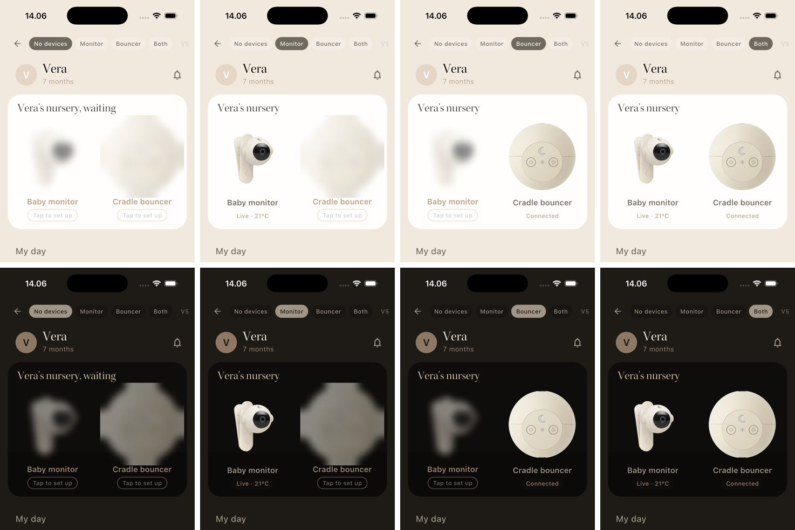

# Coffee Deck — New home: always show both device cards

**Branch:** `prototype/new-home-device-cards` · **App:** launcher → "Prototype · New home device cards"
**Ticket:** none yet (built from a verbal brief, 2026-10-09)

## The brief

**Problem.** On the new home, the Devices section changes shape with what you own: a dashed "Add device" placeholder with no devices, one full-width card plus an "Add" button with one device, two cards with both. A parent who owns one product never sees the other one, and adding a device always goes through a generic "Add" path and then the device picker.

**Change.** Always show both device cards: baby monitor and cradle bouncer. A device the account hasn't added is shown blurred, and tapping it starts setup for that device directly. There's no separate "Add" CTA.

**Constraints**
- Lives in the new home Devices section, above My Day. Old home is out of scope.
- Monitor first, matching the add-device sheet order ([moonboon_app#854](https://github.com/MoonboonInternationalApS/moonboon_app/pull/854)).
- Has to work in four states: no devices · monitor only · bouncer only · both.
- Both themes.

**Success criteria**
1. Someone with no devices understands what each device is and that one tap sets it up.
2. An owned device is obviously "mine and working", and an unowned one is obviously "not yet".
3. Home stays calm. My Day isn't pushed far down, especially for new users.
4. It's cheap to build from today's `NewHomeDeviceCard`.

**Assumptions** (smart defaults; challenge them)
- Tapping a blurred monitor opens monitor provisioning directly. Tapping a blurred bouncer opens bouncer pairing. In production the bouncer also needs a Basic/Premium choice; the prototype goes straight to Premium.
- Removing the "Add" CTA also removes the way to add a **second** monitor or a **third** bouncer from home. They'd need another entry point (Settings → Devices, or the add-device sheet from the profile). See open questions.
- With 3+ devices, production's scrolling row stays. Unowned cards only appear for a device *type* you don't own.

**How to feel it.** Every variant has a state switcher at the top (No devices / Monitor / Bouncer / Both). Tapping a blurred card opens the real setup sheet from moonboon_ui; closing it marks the device as added, so you can watch the card come into focus.

---

## V1 · The Frosted Pair — card grid (production card)

**Bet:** change the rule, not the design. The two production 106pt cards are always there side by side, and a device you don't own is the same card with its artwork frosted and "Tap to set up" as its status.

*Columns: no devices · monitor · bouncer · both. Top light, bottom dark.*

- **Optimizes for:** shippability (one new card state, no new layout) and a home that keeps the same shape in every state.
- **Sacrifices:** selling. A 106pt frosted thumbnail says little about *why* you'd want the device, and at that size "Tap to set up" is quiet.
- **Open questions:** Should the frosted card's status read "Tap to set up" or something warmer? The bouncer photo's pole crosses "Connected", and production has the same issue today.

## V2 · The Window Display — stacked, full-bleed imagery

**Bet:** an unowned device deserves a shop window, not a slot. Owned devices collapse into compact working rows. Each unowned one is a tall blurred photo with one serif promise ("See Vera sleep, from anywhere") that you tap to step into.

- **Optimizes for:** cross-sell and emotional pull. It's the only variant that says what the device *does*.
- **Sacrifices:** calm and height. With no devices, two ~200pt windows push My Day below the fold, which suits marketing but works against a parent who came to log a nap.
- **Open questions:** Who writes the promise lines? The bouncer window in light mode is mostly white because the product photo has a white backdrop, so it needs a warmer in-context shot.

## V3 · Lead & Follow — hero + companion (asymmetric)

**Bet:** what you own leads, taking two-thirds of the row as a photo card with a white status band (the Devices-page language). What you don't own follows as a narrow frosted sliver. The row is split equally when the account owns everything or nothing.

- **Optimizes for:** hierarchy. Your device is unmistakably the main thing, and the other one is present but polite. Fixed height (184pt) in every state.
- **Sacrifices:** about 78pt more height than today's 106pt row. The narrow follow tile has no room for a pitch.
- **Open questions:** Is 184pt acceptable above My Day? Should the follow tile carry a one-word hook ("Soothe", "Watch")?

## V4 · The Deck — horizontal carousel

**Bet:** a fixed-height row of tall photo cards you can swipe. Owned devices come first, and unowned ones are frosted and peek in from the screen edge. Home's height stays the same in every state, and a third or fourth device fits without a new layout.

- **Optimizes for:** scale (more devices, future products) and rich photography.
- **Sacrifices:** discoverability. The unowned card is the one half off-screen, and 248pt is the tallest fixed section here.
- **Open questions:** Snap paging or free scroll? Does the half-visible card count as "always shown" in the brief's sense?

## V5 · The Nursery Shelf — spatial, one scene

**Bet:** the devices are one system, so show them as one object: a single wide card titled "Vera's nursery" with both products standing side by side. An unowned product is a soft, out-of-focus silhouette in its spot.

- **Optimizes for:** brand and system feel. It's the most "Moonboon" moment, and the gap a missing product leaves is felt rather than explained.
- **Sacrifices:** live information. There's no room for the monitor's live preview, which production has today, so an owned device becomes a still product shot.
- **Open questions:** The blurred bouncer reads as a cream disc. Would a side-on cutout read better? Where does a second monitor go?

---

## Comparison

| | 1 · Understandable when empty | 2 · Mine vs. not-yet | 3 · Calm / My Day visible | 4 · Cheap to build |
|---|---|---|---|---|
| V1 Frosted Pair | ◐ small, quiet | ◐ frosted vs. solid | ● same 106pt as today | ● one card state |
| V2 Window Display | ● says what it does | ● very different cards | ○ tall when empty | ◐ new window card |
| V3 Lead & Follow | ◐ product shot + name | ● size *and* focus | ◐ +78pt, fixed | ◐ new layout, existing parts |
| V4 The Deck | ◐ photo, half hidden | ◐ frosted vs. solid | ◐ 248pt, fixed | ◐ new card + carousel |
| V5 Nursery Shelf | ◐ product, little copy | ● crisp vs. silhouette | ◐ ~280pt, fixed | ○ loses live preview |

## Recommendation: V3 · Lead & Follow

V3 is the only variant where the *relationship* changes with ownership. The device you own grows into the lead and the one you don't steps back, so each of the four states gets a layout that fits it without four different designs. It keeps the live monitor preview, reuses the Devices-page card language engineers already know, and stays a fixed height, so home never jumps.

I'd borrow one thing from V2: give the follow tile a two-word hook under the name, so it sells a little and doesn't only label.

If we need the smallest possible change first, ship **V1** as a stepping stone. It's a single new state on today's card, and V3 can follow once we see whether the frosted cards get tapped at all.

## Notes

- Built on top of the Settings prototype branch (`prototype/CU-86cavd37q-settings`) to reuse its launcher. Product artwork is copied from moonboon_app `dev`.
- Debug-only screenshot remote: write `hd <v1..v5> <none|monitor|bouncer|both> <light|dark>` to the app's `tmp/remote.txt` on the simulator and the app jumps to that state.
- Per-state full screenshots are in `shots/`.
