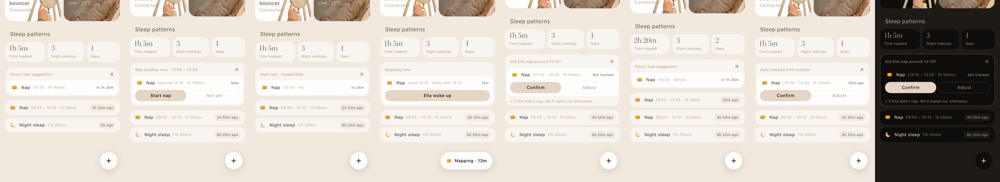
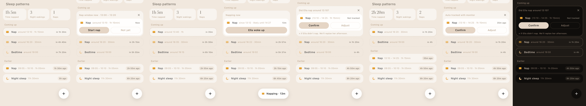
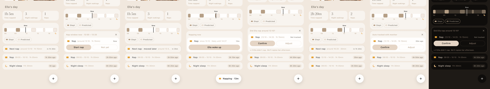
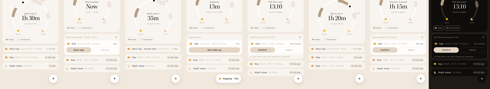
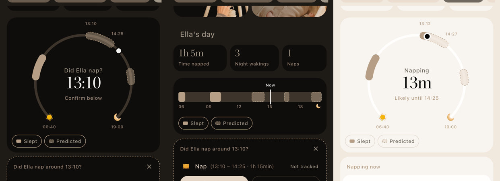

# Predicted naps on Home: coffee deck

**Source:** Figma "Home - IA", page "Suggested naps ⏳" (`oPvKdrg8UiJqjL86GXau5K`, `2565:9120`), Explorations 1–4.
**Branch:** `prototype/predicted-naps` (on top of `prototype/new-home-device-cards`).

## The problem
Home shows only what already happened. Parents want to prepare for what's next: when Ella will probably need her next nap and bedtime, and how sure we are.

**Constraints:** use today's Home (devices, sleep stats, event rows), no new navigation, light and dark.
**Success:** at a glance a parent knows the next nap. When the moment comes, one tap records what happened. Nothing nags, and auto-tracking never doubles up.

**Assumptions in the prototype:**
- **Window:** opens 10 minutes before the predicted start and stays open until the predicted end.
- **"Not yet":** moves the nap about 30 minutes later and makes it a little shorter.
- **"Did Ella nap?":** asked only after the predicted end, when nothing was tracked.
- **× / "She didn't nap":** drops the nap and replans the afternoon.
- **Monitor:** when it detects the nap, its auto-track card takes over, so there's never a second card.
- **Replanning:** every later nap and bedtime is re-predicted from what actually happened, using a 1h 55m wake window and 2h 10m before bed.
- **Shared model:** all four versions run on the same plan (`plan.dart`), so the same taps give the same day in every version.

## How to test
Open the launcher, then **Prototype · Predicted naps**. The bar at the top of each version has:
- **Clock jumps:** 11:40 before, 13:05 in window, 13:25 later, 15:00 after, 17:15 evening.
- **+15 min:** moves the clock on.
- **Monitor detects nap:** simulates auto-tracking.
- **Reset**
- **Theme:** switches light and dark.

The nap itself is driven from the cards: Start nap, Not yet, ×, Ella woke up, Confirm, and Adjust (a review sheet pre-filled with the predicted times).

In E3 and E4 you can also tap a block on the ribbon or arc, and tap the Slept/Predicted chips to filter the list.

Each sheet shows eight states, left to right: before, in window, after "Not yet", running, after the window, confirmed, monitor auto-tracked, and dark.

---

## E1 · Next nap card (existing components)
**Bet:** add nothing new. The auto-track "Smart nap suggestion" card sits on top of today's list and changes in place through the nap's life.
**Optimises:** shipping cost, and one pattern for confirming naps (auto-tracked or predicted).
**Sacrifices:** only the next nap is visible, with no sense of the rest of the day or bedtime.

## E2 · Coming up list
**Bet:** the rest of the day joins the list as dashed "Coming up" rows above "Earlier". The nap in focus becomes the action card in place.
**Optimises:** the whole plan in words, including bedtime, with countdowns that are easy to scan.
**Sacrifices:** it's long. Real events slide below the fold, and it reads as a to-do list.

## E3 · Timeline ribbon
**Bet:** "Ella's day" as a 06–20 ribbon. Slept is solid and predicted is dashed, with a Now line. The cards underneath carry the actions.
**Optimises:** a sense of rhythm, past and future in one glance, and tapping a block for detail (likely window, wind-down reminder).
**Sacrifices:** blocks are small and hard to tap, and it needs the legend to explain itself.

## E4 · Day arc (Napper-style)
**Bet:** Napper's open arc from wake-up (sun) to bedtime (moon), with naps along the arc and a big Kepler countdown in the middle: "Next nap in 1h 30m", "Nap window Now", "Napping 13m", "Did Ella nap?".
**Optimises:** emotion and the single most important number. It's the most "Moonboon moment" of the four.
**Sacrifices:** height (about 300pt), a 30-minute nap shows as a dot, and the night isn't shown.

---

## Comparison

| | Next nap at a glance | Whole day / bedtime | Act in the moment | Calm, not naggy | Build cost |
|---|---|---|---|---|---|
| E1 card | ✅ | ❌ | ✅ | ✅ | Lowest |
| E2 list | ✅ | ✅ in words | ✅ | ⚠️ long | Low |
| E3 ribbon | ⚠️ small | ✅ visual | ✅ | ✅ | Medium |
| E4 arc | ✅✅ | ✅ visual, no night | ✅ | ✅ | Medium–high |

## Recommendation
Build **E4's arc with E1's card underneath**. That's what E4 already does: the arc answers "when is the next nap?" better than anything else and feels like Moonboon, and the action card is the same auto-track pattern parents already know. Keep E3's tap-a-block detail (likely window and the "Remind me at 12:50" wind-down) on the arc. Drop E2's long list. Its bedtime row is covered by the moon at the end of the arc.

## Open questions for the PM
- Should "Not yet" ask "how much later?" or keep moving the nap 30 minutes?
- After 1 hour, does an unanswered "Did Ella nap?" become a quiet row in Earlier, or disappear at bedtime?
- Confidence: show "Based on 7 days" everywhere, or only in the tap detail?
- Should the + button turn into the ongoing "Napping · 13m" pill (built here), or stay a +?
